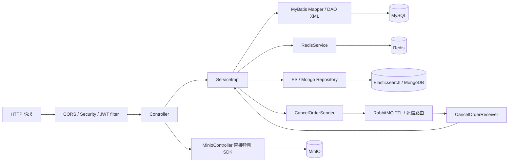

# mall-learning 程式碼與架構導覽

> 用途：之後接到修改需求時，先用本檔選定模組，再沿著入口、業務邏輯、資料存取與設定定位程式。
> 盤點日期：2026-10-04；程式基準：`cd02c00`（合并teach分支，升级新版代码）。
> 本檔依本地 POM、Java、XML、YAML、SQL、測試與部署檔靜態閱讀整理；未啟動應用、連線外部服務或執行建置／測試。教學文章與實碼不一致時，以目前程式碼為準。

## 1. 先掌握 repo 的邊界

- 這是 **22 個 Spring Boot 教學範例專案 + Docsify 文件網站 + 資料／圖稿素材**。根 POM 聚合其中 20 個模組，各模組之間沒有互相引用的 Maven dependency。
- 各模組各有自己的 `MallTinyApplication`、POM、設定與重複類別，是分別啟動的應用；不能將全部 Java 目錄當成同一個應用的 classpath。
- `mall-tiny` 是涵蓋品牌 CRUD、JWT、Redis、Elasticsearch、MongoDB、RabbitMQ、MinIO 的整合示範；`mall-tiny-01` 到 `08` 是逐步加入功能的程式副本。整合版與 `08` 功能接近，但不是逐檔完全相同。
- README 與 docs 也介紹外部 `mall`、`mall-admin-web`、`mall-app-web`、`mall-swarm`。這個 repo 沒有完整商城後台／前台、Vue 商城前端或 Spring Cloud 微服務實作。
- **同名類別不代表共用程式碼。** 修改 `mall-tiny` 的 `PmsBrandServiceImpl` 不會改到其他模組；接到需求時先確認目標範例及是否需要同步其他副本。

根目錄入口：[建置設定](pom.xml)、[原始專案介紹](README.md)、[文件站首頁](docs/README.md)、[MySQL 初始化 SQL](document/sql/mall_tiny.sql)、[PostgreSQL 初始化 SQL](document/sql/mall_tiny_postgre.sql)。

## 2. 修改需求快速索引

本檔以以下縮寫表示「選定模組內」的路徑，避免表格反覆列出長前綴：

- `J/` = `<模組>/src/main/java/com/macro/mall/tiny/`
- `R/` = `<模組>/src/main/resources/`
- `T/` = `<模組>/src/test/java/com/macro/mall/tiny/`

例如 `mall-tiny` 的 `J/controller/PmsBrandController.java` 就是 [這個檔案](mall-tiny/src/main/java/com/macro/mall/tiny/controller/PmsBrandController.java)。未指定模組的下表整合功能，以 `mall-tiny` 為閱讀起點，實際修改仍依需求選定模組。

| 要改什麼 | 先選哪個模組 | 主要檔案／符號與連動位置 |
| --- | --- | --- |
| 品牌新增、修改、刪除、分頁 | `mall-tiny` 或對應編號範例 | `J/controller/PmsBrandController.java` → `J/service/impl/PmsBrandServiceImpl.java` → `J/mbg/mapper/PmsBrandMapper.java`；SQL 在 `R/com/macro/mall/tiny/mbg/mapper/PmsBrandMapper.xml` |
| API 回傳格式、業務錯誤碼、分頁欄位 | 需求所屬模組 | `J/common/api/{CommonResult,ResultCode,IErrorCode,CommonPage}.java`；各模組各有副本，部分沒有 `CommonPage` |
| 登入、帳號來源、JWT | `mall-tiny`、`04`–`08`；另有 `boot`／`swagger` 版本 | `UmsAdminController`、`UmsAdminServiceImpl`、`AdminUserDetails`、`JwtTokenUtil`、`JwtAuthenticationTokenFilter`；整合版與 `04`–`08` 另看 `MallSecurityConfig` |
| 權限、匿名 API、跨域 | `mall-tiny` 或對應範例 | `J/config/{SecurityConfig,IgnoreUrlsConfig,GlobalCorsConfig}.java`、`R/application.yml` 的 `secure.ignored.urls`、Controller 的 `@PreAuthorize`；不是每個模組都有這三個設定類別 |
| 驗證碼產生、有效時間、校驗 | `mall-tiny`、`03`–`08` | `J/controller/UmsMemberController.java`、`J/service/impl/UmsMemberServiceImpl.java`、`RedisServiceImpl`；YAML 的 `redis.key.*` |
| 品牌快取、Redis 資料結構操作 | `mall-tiny-redis` | `J/service/impl/PmsBrandServiceImpl.java` 的 `@Cacheable`／`@CacheEvict`；`J/controller/RedisController.java`、`RedisServiceImpl`、`J/config/RedisConfig.java` |
| 商品搜尋、ES 欄位、資料匯入 | `mall-tiny`、`05`–`08` | `EsProductController` → `EsProductServiceImpl` → `J/nosql/elasticsearch/`；MySQL 來源在 `J/dao/EsProductDao.java` + `R/dao/EsProductDao.xml` |
| 會員瀏覽歷史 | `mall-tiny`、`06`–`08` | `MemberReadHistoryController` → `MemberReadHistoryServiceImpl` → `J/nosql/mongodb/{document,repository}/` |
| 下單後延遲取消、訊息 TTL／路由 | `mall-tiny`、`07`–`08` | `OmsPortalOrderServiceImpl`、`J/component/{CancelOrderSender,CancelOrderReceiver}.java`、`J/config/RabbitMqConfig.java`、`J/dto/QueueEnum.java` |
| RabbitMQ 五種基本訊息模式 | `mall-tiny-rabbit` | `J/controller/RabbitController.java`；`J/{simple,work,fanout,direct,topic}/` 各有 Config／Sender／Receiver |
| 檔案上傳、刪除、MinIO bucket／公開網址 | `mall-tiny`、`mall-tiny-08` | `J/controller/MinioController.java` 直接呼叫 SDK；`J/dto/{MinioUploadDto,BucketPolicyConfigDto}.java`、YAML `minio.*`／`spring.servlet.multipart.*` |
| 管理員 DB CRUD、關聯查詢／手寫 SQL | `mall-tiny-generator`／`mall-tiny-mybatis` | generator 的 `UmsAdminController`、`UmsAdminServiceImpl`；兩者的 `J/dao/`、`R/dao/` 與 model／DTO；不要找 JWT 示範的記憶體帳號服務 |
| 選單樹、Java Stream 資料轉換 | `mall-tiny-stream` | `J/controller/UmsMenuController.java` → `J/service/impl/UmsMenuServiceImpl.java` 的 `treeList`／`covertMenuNode`；`J/dto/UmsMenuNode.java`、`T/stream/StreamApiTest.java` |
| MyBatis-Plus CRUD／分頁／產碼 | `mall-tiny-plus` | `J/modules/pms/`、`J/config/MyBatisConfig.java`、`J/generator/MyBatisPlusGenerator.java`、`R/mapper/pms/PmsBrandMapper.xml` |
| 支付、交易查詢、支付通知、支付訂單 | `mall-tiny-alipay` | `AlipayController`／`AlipayOrderController`、`AlipayServiceImpl`／`AlipayOrderServiceImpl`、`AlipayConfig`／`AlipayClientConfig`、`AlipayOrderMapper` |
| DB、port、外部服務位置、profile | 需求所屬模組 | `R/application.yml`；docker／jenkins 另有 `R/application-prod.yml`；產碼連線另在 `R/generator.properties` |
| PostgreSQL SSH tunnel 的建立／關閉／狀態 | repo 根目錄 | [db-tunnel.sh](db-tunnel.sh) 的 `start`／`stop`／`status`；設定範本 [.db-tunnel.env.example](.db-tunnel.env.example)，實際本機設定 `.db-tunnel.env` 不納入 Git |
| Swagger 顯示、掃描範圍、Authorization | 對應模組的 `J/config/SpringDocConfig.java` | 同時看 Controller 的 Swagger 註解及 YAML `springdoc.packages-to-scan` |
| Docker／Jenkins 建置部署 | `mall-tiny-docker`／`mall-tiny-jenkins` | 各自 `pom.xml`、`src/main/docker/`、`R/application-prod.yml`；Jenkins shell 與 Dockerfile／Compose 有不一致，見第 8 節 |
| 教學內容、網站導覽、文件圖片 | `docs/` | `docs/index.html`、`_sidebar.md`、`_navbar.md`、各主題 Markdown、`images/`；修改文章不會修改 Java 行為 |

## 3. 模組全覽

### 3.1 編號範例與整合版

下表是**實際程式內容**，不是舊文章中的模組編號。後面的編號大致保留前面範例的功能，再加入一項整合。

| 模組 | 本階段內容 | 主要新增入口 |
| --- | --- | --- |
| [mall-tiny-01](mall-tiny-01/) | Spring MVC + MyBatis／PageHelper 品牌 CRUD | `PmsBrandController`、`PmsBrandServiceImpl`、`PmsBrandMapper` |
| [mall-tiny-02](mall-tiny-02/) | 加 Swagger API 文件；此模組已改用 PostgreSQL | `SpringDocConfig`、Controller 註解與 `R/application.yml` 的 `spring.datasource.*` |
| [mall-tiny-03](mall-tiny-03/) | 加 Redis 驗證碼 | `UmsMemberController`、`UmsMemberServiceImpl`、`RedisConfig`／`RedisService` |
| [mall-tiny-04](mall-tiny-04/) | 加 Spring Security + JWT、品牌方法權限 | `UmsAdminController`、`SecurityConfig`、`MallSecurityConfig`、JWT filter |
| [mall-tiny-05](mall-tiny-05/) | 加 Elasticsearch 商品搜尋 | `EsProductController`、`EsProductDao`、`nosql/elasticsearch/` |
| [mall-tiny-06](mall-tiny-06/) | 加 MongoDB 瀏覽歷史 | `MemberReadHistoryController`、`nosql/mongodb/` |
| [mall-tiny-07](mall-tiny-07/) | 加 RabbitMQ 延遲取消訂單示範 | `OmsPortalOrderController`、`CancelOrderSender`／`Receiver`、`RabbitMqConfig` |
| [mall-tiny-08](mall-tiny-08/) | 加 MinIO 與全域 CORS | `MinioController`、`GlobalCorsConfig` |
| [mall-tiny](mall-tiny/) | 上述功能的整合範例 | 第 5 節以此模組解說完整呼叫路徑 |

### 3.2 技術專題與部署範例

| 模組 | 實際用途與定位重點 |
| --- | --- |
| [mall-tiny-boot](mall-tiny-boot/) | Spring Boot 範例，已有品牌 CRUD、Swagger、記憶體帳號與 JWT；不是空白骨架。`SecurityConfig` 同時提供 `UserDetailsService`，白名單由 `IgnoreUrlsConfig` 載入。 |
| [mall-tiny-mybatis](mall-tiny-mybatis/) | 手寫 MyBatis CRUD、動態 SQL、關聯映射；主軸是 `J/dao/` + `R/dao/` + `T/test/`，沒有 REST Controller；模型在 `J/model/`。 |
| [mall-tiny-generator](mall-tiny-generator/) | MyBatis Generator 產生的管理員等 mapper／model，再搭配 `UmsAdminController` 與 `UmsAdminDao` 的進階查詢；API 資料來自 DB。 |
| [mall-tiny-lombok](mall-tiny-lombok/) | Lombok 註解的可執行 Java 範例；看 `J/example/` 的 `GetterSetterExample`、`BuilderExample`、`DataExample`、`LogSlf4jExample` 等；沒有業務 HTTP Controller 或 DB。 |
| [mall-tiny-hutool](mall-tiny-hutool/) | Hutool 工具範例；看 `J/controller/HutoolController.java`；沒有 DB 存取依賴。 |
| [mall-tiny-swagger](mall-tiny-swagger/) | Swagger 與 JWT 文件認證範例，也有品牌 CRUD；安全白名單直接寫在 `SecurityConfig`，和整合版拆分配置不同。 |
| [mall-tiny-redis](mall-tiny-redis/) | Spring Cache 品牌快取 + Redis 各種資料結構操作；不是 `03` 的手機驗證碼範例。 |
| [mall-tiny-rabbit](mall-tiny-rabbit/) | simple、work、fanout、direct、topic 五種 RabbitMQ 模式；沒有品牌／訂單 DB 業務。 |
| [mall-tiny-stream](mall-tiny-stream/) | Java Stream API、選單樹與測試，另保留品牌 CRUD；不是 Spring Cloud Stream。 |
| [mall-tiny-plus](mall-tiny-plus/) | MyBatis-Plus 品牌 CRUD；使用 `modules/pms/{controller,service,mapper,model}`，不是 `mbg/` 分層。 |
| [mall-tiny-docker](mall-tiny-docker/) | 品牌 CRUD + Dockerfile／Compose／Fabric8 Maven 建置。 |
| [mall-tiny-jenkins](mall-tiny-jenkins/) | 品牌 CRUD + 部署 shell；**未列入根 reactor**，POM 直接繼承 Spring Boot parent，獨立維護版本。 |
| [mall-tiny-alipay](mall-tiny-alipay/) | 支付寶沙箱支付／通知／訂單範例；**未列入根 reactor**，但仍繼承根 POM。 |

## 4. 共通架構與資料分層

### 4.1 一個典型模組的目錄

```text
<module>/
  pom.xml
  src/main/java/com/macro/mall/tiny/
    MallTinyApplication.java       Spring Boot main 入口
    controller/                    HTTP 路由、request／response 轉換
    service/ + service/impl/        業務介面與實作
    config/                        Spring beans、外部整合、安全與 Swagger
    component/                     JWT filter、MQ sender／receiver 等
    common/api/                    CommonResult、CommonPage、ResultCode
    common/utils/                  JWT 等工具
    dto/、domain/                  傳輸物件、組合資料、安全模型
    dao/                           手寫資料查詢介面
    mbg/mapper/ + mbg/model/        MyBatis Generator 產出
    nosql/                         ES／MongoDB document 與 repository
  src/main/resources/
    application.yml                執行時設定
    dao/*.xml                      手寫 MyBatis SQL
    com/macro/mall/tiny/mbg/mapper/  產生的 MyBatis XML
    generatorConfig.xml            MBG 產碼表名、位置、插件
    generator.properties           產碼用 DB 連線
  src/test/java/                   測試／教學用整合範例
```

這是整合版的結構，不代表每個範例都有所有目錄。`mall-tiny-plus`、`mall-tiny-mybatis` 的例外見模組表。

### 4.2 請求與資料流（以 mall-tiny 為例）



- `MallTinyApplication` 從 `com.macro.mall.tiny` 掃描 Spring 元件；`MyBatisConfig` 掃描 `mbg.mapper` 與 `dao`。
- `R/application.yml` 的 `mybatis.mapper-locations` 載入 `classpath:dao/*.xml` 與 `classpath*:com/**/mapper/*.xml`。改 DAO 時要同時核對介面、XML namespace／statement id、resultMap 及 DTO 欄位。
- 多數 Controller 使用 `@Controller` + 方法上的 `@ResponseBody`，也有 `@RestController`；回傳多包在 `CommonResult<T>` 的 `code/message/data`。
- `CommonPage<T>` 包裝 `pageNum/pageSize/totalPage/total/list`；整合版同時接收 PageHelper 的 `List` 與 Spring Data 的 `Page`。
- `ResultCode` 的數值是 JSON 業務碼，不能直接當成 HTTP status。整合版的認證／授權 handler 只寫 JSON，未明確呼叫 `response.setStatus(...)`。

## 5. 整合版的主要流程與修改位置

本節檔案皆以 `mall-tiny` 為準；對應編號模組通常有同名副本。

### 5.1 品牌 CRUD 與分頁

入口：[PmsBrandController](mall-tiny/src/main/java/com/macro/mall/tiny/controller/PmsBrandController.java) → [PmsBrandServiceImpl](mall-tiny/src/main/java/com/macro/mall/tiny/service/impl/PmsBrandServiceImpl.java) → [PmsBrandMapper](mall-tiny/src/main/java/com/macro/mall/tiny/mbg/mapper/PmsBrandMapper.java) + [XML](mall-tiny/src/main/resources/com/macro/mall/tiny/mbg/mapper/PmsBrandMapper.xml) → MySQL `pms_brand`。

- 路由：`GET /brand/listAll`、`GET /brand/list`、`GET /brand/{id}`、`POST /brand/create`、`POST /brand/update/{id}`、`GET /brand/delete/{id}`。現有刪除介面使用 GET，若改 HTTP 方法要連同呼叫端契約處理。
- 建立使用 `insertSelective`；更新先把 path id 設到 model，再 `updateByPrimaryKeySelective`，null 欄位不會直接當成清空值更新。
- 分頁先 `PageHelper.startPage(pageNum, pageSize)`，再執行 mapper 查詢；預設頁碼從 **1** 開始。
- 欄位與查詢條件在 `mbg/model/PmsBrand.java`、`PmsBrandExample.java`；新增欄位時同步考慮 SQL schema、mapper XML 與產碼設定。

### 5.2 登入、JWT、API 權限

入口：[UmsAdminController](mall-tiny/src/main/java/com/macro/mall/tiny/controller/UmsAdminController.java)、[UmsAdminServiceImpl](mall-tiny/src/main/java/com/macro/mall/tiny/service/impl/UmsAdminServiceImpl.java)、[SecurityConfig](mall-tiny/src/main/java/com/macro/mall/tiny/config/SecurityConfig.java)。

1. `POST /admin/login` 接收 `@RequestParam username/password`，不是 JSON 登入 DTO。
2. `UmsAdminServiceImpl.login` 取得 `AdminUserDetails`，以 `PasswordEncoder` 驗證，交由 `common/utils/JwtTokenUtil` 產生 token，回傳 `token` 與 `tokenHead`。
3. 後續請求由 `component/JwtAuthenticationTokenFilter` 讀取 Authorization，透過 `MallSecurityConfig` 提供的 `UserDetailsService` 取得使用者，驗證 token 後寫入 `SecurityContextHolder`。
4. `SecurityConfig` 採無 session 設定；白名單在 `IgnoreUrlsConfig` + YAML `secure.ignored.urls`。品牌操作另用 `@PreAuthorize("hasAuthority('brand:...')")`；`GET /brand/{id}` 沒有額外的方法權限註解。
5. 未登入／無權限的回應分別在 `component/RestAuthenticationEntryPoint.java` 與 `RestfulAccessDeniedHandler.java`。

**目前帳號與資源清單在 `UmsAdminServiceImpl.init()` 的記憶體清單內，沒有讀 `ums_admin` 表。** `POST /admin/resourceList` 也只是回傳範例資源清單，沒有完整 DB RBAC 管理。若要持久化帳號／權限，需改帳號查詢與 authorities 來源，不能只改初始化 SQL。整合版 YAML 還放行了 `/admin/**`、`/esProduct/**`、`/sso/**` 等示範路由，新增 API 時要一起檢查。

版本差異：`04`–`08` 的 YAML 未放行 `/sso/**`；`boot`／`swagger` 的品牌權限採 `hasRole('ADMIN')`，除 `listAll` 只需登入，其餘品牌方法包含列表與詳情都要求 ADMIN。不要將整合版的白名單或 authority 規則直接視為每個模組的共同設定。

### 5.3 Redis 驗證碼與品牌快取是兩條不同路徑

- 整合版入口：[UmsMemberController](mall-tiny/src/main/java/com/macro/mall/tiny/controller/UmsMemberController.java) → [UmsMemberServiceImpl](mall-tiny/src/main/java/com/macro/mall/tiny/service/impl/UmsMemberServiceImpl.java)。`GET /sso/getAuthCode` 產生六位數字，寫入「prefix + telephone」Redis key 並設定 TTL；`POST /sso/verifyAuthCode` 比對 Redis 值。
- prefix／TTL 由 YAML `redis.key.prefix.authCode`、`redis.key.expire.authCode` 控制；目前 TTL 為 120 秒。這是**直接回傳驗證碼**的示範，沒有發送 SMS，也沒有真正更新密碼；校驗成功不刪除驗證碼。
- Redis 操作封裝在 `J/service/RedisService.java`、`J/service/impl/RedisServiceImpl.java`；序列化與 cache manager 在 `J/config/RedisConfig.java`，整合版 cache manager 預設 TTL 一天。
- cache manager 的 TTL 不等於所有 Redis 寫入的 TTL；`RedisService.set(key, value)` 本身不帶一天有效期，驗證碼另外呼叫 `expire`。
- 品牌快取的實際使用在 [mall-tiny-redis 的 PmsBrandServiceImpl](mall-tiny-redis/src/main/java/com/macro/mall/tiny/service/impl/PmsBrandServiceImpl.java)：`getItem` 用 `@Cacheable`，`update/delete` 用 `@CacheEvict`，cache name 取 `RedisConfig.REDIS_KEY_DATABASE`，key expression 是 `pms:brand:` + id。整合版品牌 service 沒有這些快取註解。

### 5.4 Elasticsearch 商品索引與搜尋

入口：[EsProductController](mall-tiny/src/main/java/com/macro/mall/tiny/controller/EsProductController.java) → [EsProductServiceImpl](mall-tiny/src/main/java/com/macro/mall/tiny/service/impl/EsProductServiceImpl.java)。

- 匯入：`POST /esProduct/importAll` → `EsProductDao.getAllEsProductList(null)` → [EsProductDao.xml](mall-tiny/src/main/resources/dao/EsProductDao.xml) 讀 `pms_product`、`pms_product_attribute_value`、`pms_product_attribute` → `EsProductRepository.saveAll`。
- SQL 只讀 `delete_status = 0` 且 `publish_status = 1` 的商品；新增搜尋欄位通常需一起改 SQL／resultMap、`EsProduct` 與 repository 查詢。
- 搜尋：`GET /esProduct/search/simple` → `findByNameOrSubTitleOrKeywords`；`pageNum` 從 **0** 開始，和品牌 MyBatis 分頁不同。
- 單筆同步用 `POST /esProduct/create/{id}`；刪除為 `GET /esProduct/delete/{id}`／`POST /esProduct/delete/batch`。這些刪除操作作用於 ES 索引，沒有刪 MySQL 商品。
- [EsProduct](mall-tiny/src/main/java/com/macro/mall/tiny/nosql/elasticsearch/document/EsProduct.java) 指定索引 `pms`，名稱／副標題／關鍵字使用 `ik_max_word`，屬性清單為 Nested。ES 環境需能支援該 analyzer；程式沒有自動同步所有商品異動的管線。

### 5.5 MongoDB 會員瀏覽紀錄

入口：[MemberReadHistoryController](mall-tiny/src/main/java/com/macro/mall/tiny/controller/MemberReadHistoryController.java) → [MemberReadHistoryServiceImpl](mall-tiny/src/main/java/com/macro/mall/tiny/service/impl/MemberReadHistoryServiceImpl.java) → `nosql/mongodb/repository/MemberReadHistoryRepository`。

- `POST /member/readHistory/create` 清空傳入 id、填入目前時間再 save；document 在 `nosql/mongodb/document/MemberReadHistory.java`。
- `POST /member/readHistory/delete` 批次刪除；`GET /member/readHistory/list` 依 memberId 查詢、createTime 倒序。
- 資料保存在 MongoDB；會員資訊來自請求參數，不是從已登入帳號推導。要調整去重、欄位、列表條件或登入關聯，從上述三層著手。

### 5.6 RabbitMQ 延遲取消訂單

入口：[OmsPortalOrderServiceImpl](mall-tiny/src/main/java/com/macro/mall/tiny/service/impl/OmsPortalOrderServiceImpl.java)、[RabbitMqConfig](mall-tiny/src/main/java/com/macro/mall/tiny/config/RabbitMqConfig.java)、[QueueEnum](mall-tiny/src/main/java/com/macro/mall/tiny/dto/QueueEnum.java)。

```text
POST /order/generateOrder
  → OmsPortalOrderServiceImpl.generateOrder
  → CancelOrderSender.sendMessage（設定每則訊息 expiration）
  → exchange mall.order.direct.ttl → queue mall.order.cancel.ttl
  → TTL 到期，由死信交換機 mall.order.direct 路由至 mall.order.cancel
  → CancelOrderReceiver.handle → OmsPortalOrderServiceImpl.cancelOrder
```

目前固定傳入 `orderId = 11L`，延遲 **30 秒**；真正下單與取消訂單都只是 TODO／log，沒有訂單落庫、庫存扣回或付款檢查。改 queue 名稱時，除 `QueueEnum` 與配置外，也要核對 receiver 的 `@RabbitListener(queues = "mall.order.cancel")`。此範例使用 TTL + dead-letter，不是 RabbitMQ 延遲交換機插件。

### 5.7 MinIO 檔案管理

入口：[MinioController](mall-tiny/src/main/java/com/macro/mall/tiny/controller/MinioController.java)。此處沒有獨立的檔案 service，Controller 直接建立 `MinioClient`。

- `POST /minio/upload` 接收 multipart 欄位 `file`；bucket 不存在時建立並設定讀取 policy。
- 物件名稱為 `yyyyMMdd/原檔名`，回傳 `MinioUploadDto` 的 name 與組合後 URL。若需求涉及唯一檔名、目錄規則或公開網址，改這裡及 `BucketPolicyConfigDto`。
- `POST /minio/delete` 接收 `objectName`；endpoint、bucket、存取設定在 YAML `minio.*`，檔案大小上限在 `spring.servlet.multipart.*`。

## 6. 專題模組的額外定位

| 主題 | 需一起閱讀的檔案／行為 |
| --- | --- |
| 手寫 MyBatis | `mall-tiny-mybatis` 的 `J/dao/{UmsAdminDao,UmsResourceDao,UmsResourceCategoryDao}.java` 與 `R/dao/` 同名 XML；關聯資料在 `J/domain/{UmsResourceExt,UmsResourceCategoryExt}.java`。示範呼叫在 `T/test/MyBatisBaseTest.java`、`MyBatisTagTest.java`、`MyBatisAdvanceTest.java`。 |
| MBG 管理員查詢 | `mall-tiny-generator` 的 `J/service/impl/UmsAdminServiceImpl.java` 分別使用 generated mapper／Example 與手寫 `UmsAdminDao`；`R/dao/UmsAdminDao.xml` 處理額外查詢；`J/domain/{AdminRoleDto,ResourceWithCateDto,RoleStatDto}.java` 封裝關聯結果。 |
| 選單樹 | `mall-tiny-stream` 的 `GET /menu/treeList` → `UmsMenuServiceImpl.treeList()` 先讀全部 `ums_menu`，以 `parentId=0` 找根，再於 `covertMenuNode` 逐層 filter 全部選單並遞迴建立 `UmsMenuNode.children`；資料讀取在 `mbg/mapper/UmsMenuMapper`。 |
| MyBatis-Plus | `mall-tiny-plus` 的 `modules/pms/mapper/PmsBrandMapper` 繼承 `BaseMapper`；`PmsBrandServiceImpl` 是空的 `ServiceImpl` 子類，Controller 直接呼叫繼承的 CRUD／page，沒有自訂查詢條件。分頁參數在 `PmsBrandController.listBrand`，interceptor 在 `J/config/MyBatisConfig.java`；更新 API 為 `POST /brand/update`，id 放 body。 |
| RabbitMQ 基本模式 | `mall-tiny-rabbit` 的 `GET /rabbit/{simple,work,fanout,direct,topic}` 各發送 10 次、每次 sleep 1 秒，是同步示範流程；五組 Config 同時載入，沒有模式啟用開關。 |
| Hutool／Lombok | Hutool 的入口集中在 `J/controller/HutoolController.java`，包括字串、轉換、JSON、HTTP、captcha 等示範；`/hutool/covert` 是程式現有拼字，captcha 回 PNG。Lombok 從 `J/example/` 的各個 main 方法閱讀。 |
| 支付寶訂單 | `mall-tiny-alipay` 的 `POST /alipayOrder/create`／`GET /alipayOrder/info/{orderId}` → `AlipayOrderServiceImpl` → `AlipayOrderMapper` + 對應 XML；此為測試商品訂單流程。 |
| 支付寶支付／通知 | 同模組的 `GET /alipay/pay`（電腦支付）、`GET /alipay/webPay`（手機支付）、`POST /alipay/notify`、`GET /alipay/query` → `AlipayServiceImpl`；通知驗簽後遇 `TRADE_SUCCESS`，依 `out_trade_no` 更新訂單。配置在 `AlipayConfig`、`AlipayClientConfig` 及 YAML `alipay.*`。支付參數在 `J/dto/AliPayParam.java`。 |

支付模組的 gateway 指向沙箱，appId／金鑰仍為待填 placeholder，notifyUrl 為空；repo SQL 也沒有 `alipay_order` 表，單純匯入 `mall_tiny.sql` 不足以跑通支付訂單。

## 7. 資料庫、產生碼與版本設定

### 7.1 SQL 與命名

[document/sql/mall_tiny.sql](document/sql/mall_tiny.sql) 包含建表與示範資料，共 13 張表：

- 商品：`pms_brand`、`pms_product`、`pms_product_attribute`、`pms_product_attribute_value`。
- 使用者／權限：`ums_admin`、`ums_admin_login_log`、`ums_admin_role_relation`、`ums_menu`、`ums_resource`、`ums_resource_category`、`ums_role`、`ums_role_menu_relation`、`ums_role_resource_relation`。

檔案沒有 `CREATE DATABASE`／`USE`，需要先選定目標資料庫；有 `DROP TABLE IF EXISTS`，匯入會重建同名資料表。它不是完整商城 schema，也沒有完整 `oms_*` 訂單表與 `sms_*` 行銷表。名稱慣例：Pms 為商品、Ums 為使用者／會員／權限、Oms 為訂單；文件另介紹 Sms 行銷。

增量更新日期：2026-10-09；此更新只涵蓋初始化 SQL，其他模組仍以原盤點範圍為準。

- [document/sql/mall_tiny_postgre.sql](document/sql/mall_tiny_postgre.sql) 為 PostgreSQL 10+ 版本，保留相同 13 張表、442 筆示範資料、主鍵與註解；使用 `GENERATED BY DEFAULT AS IDENTITY (START WITH ...)` 接續原本的自動編號。
- 在已建立的 UTF-8 目標資料庫執行：`psql -X -v ON_ERROR_STOP=1 -d mall_tiny -f document/sql/mall_tiny_postgre.sql`。腳本在單一交易中重建目前 `search_path` 下的同名表，字串比對使用目標資料庫預設 collation。
- 此檔只提供 PostgreSQL 初始化資料；`mall-tiny-02` 已調整 JDBC、datasource 與 MyBatis／PageHelper 設定，其餘資料庫模組仍使用 MySQL。
- 2026-10-09 已用 `pglast` 解析全部 565 個 PostgreSQL 敘述，並以 `sqlglot` 解析 MySQL 原檔，核對 13 張表／120 個欄位的型別、可空性、預設值、主鍵、93 項註解、442 筆資料與 identity 起始值；尚未連線 PostgreSQL 實際匯入。

### 7.2 產碼修改界線

- 多數模組的 `J/mbg/Generator.java` 是可執行的 `main`，讀 `R/generatorConfig.xml` + `generator.properties`；不會因一般編譯就自動執行。
- `mbg/model/*`、`mbg/mapper/*`、對應 resources XML 是產生碼；手寫擴充主要在 `dao/` + `R/dao/`。重新產碼前先確認覆寫範圍與目前手寫內容。
- 整合版 `generatorConfig.xml` 目前只啟用 `pms_brand`，其他模組生成的表不同。Generator 使用 overwrite，XML 也配置 `UnmergeableXmlMappersPlugin`。
- `mall-tiny-mybatis` 的 generator 是例外：目前只產生 `J/model/`，Mapper／XML 產生區段已註解；它的 `dao/*.xml` 為手寫 SQL。`mall-tiny-generator` 產生管理員／角色／資源等表，`mall-tiny-stream` 則包含 `pms_brand` 與 `ums_menu`。
- 多個 MBG 設定的 `targetProject` 使用 `mall-tiny-...\src\main\...` 這類 Windows 相對路徑；在 macOS／Linux 執行前核對工作目錄與輸出路徑，避免寫入錯的目錄或模組。
- `mall-tiny-plus` 改用 [MyBatisPlusGenerator](mall-tiny-plus/src/main/java/com/macro/mall/tiny/generator/MyBatisPlusGenerator.java)：以 `user.dir + "/mall-tiny-plus"` 組 projectPath，互動輸入模組／表名，讀 `generator.properties`，輸出至 `modules/<模組>/` 及 `R/mapper/<模組>/`。不同於 MBG，不讀 `generatorConfig.xml`。
- 產碼 DB 設定與應用的 `application.yml` 是兩份獨立來源；只改其中一份不會同步另一份。
- `mall-tiny-02` 的 PostgreSQL 調整限應用執行期；`generator.properties`／`generatorConfig.xml` 仍是舊 MySQL 產碼設定，尚未遷移，也未重新執行產碼器。本模組 classpath 已沒有 MySQL driver，產碼器目前無法直接執行；若改回 MySQL 重新產碼，會覆蓋 `PmsBrandMapper.xml` 的 `useGeneratedKeys` 調整並重新產生 `LAST_INSERT_ID()`。

### 7.3 目前 POM 的版本基準

版本以 [根 pom.xml](pom.xml) 與所選模組 POM 為準；下列是盤點到的宣告，不表示已驗證執行環境相容性。

| 項目 | 根 POM 宣告 |
| --- | --- |
| Spring Boot／Java target | `3.5.16`／`21` |
| MyBatis／starter／Generator | `3.5.10`／`3.0.5`／`1.4.1`（MyBatis property 保留；實際使用依各模組 dependencies） |
| PageHelper starter／PageHelper | `2.1.1`／`5.3.2`（PageHelper property 保留；實際版本由 starter 帶入） |
| MySQL JDBC／Druid | `com.mysql:mysql-connector-j`（Boot 管理）／`druid-spring-boot-3-starter:1.2.28` |
| springdoc-openapi／Hutool／JJWT | `2.9.1`／`5.8.9`／`0.9.1` |
| MinIO SDK／Fabric8 Docker plugin | `8.4.5`／`0.40.2` |

根 POM 保留 JAXB 相容性依賴，供 JJWT 0.9.1 使用；`mall-tiny-jenkins` 不繼承根 POM，已同步升級其 parent、properties 與依賴管理。兩份 POM 都固定 MyBatis starter／autoconfigure 為 3.0.5，覆蓋 PageHelper 的傳遞版本。`mall-tiny-plus` 使用 MyBatis-Plus Boot 3 starter、jsqlparser 與 generator 3.5.17。Swagger 改由 `SpringDocConfig` 提供 OpenAPI 3，掃描範圍使用 YAML `springdoc.packages-to-scan`；UI／文件入口為 `/swagger-ui/index.html`／`/v3/api-docs`。

`mall-tiny-02` 的 JDBC 依賴改為 `org.postgresql:postgresql`（runtime scope；Boot 3.5.16 管理為 42.7.11），其餘資料庫模組保留 MySQL driver。

增量更新日期：2026-10-12；此更新只涵蓋 Spring Boot 3 升級的版本、Swagger 導覽與 Redis 設定鍵，以 `spring-boot-3-upgrade` 分支的變更核對；其他區域仍以原盤點範圍為準。

## 8. 執行、建置與部署定位

### 8.1 設定檔與外部服務

整合版設定：[mall-tiny/src/main/resources/application.yml](mall-tiny/src/main/resources/application.yml)。

| 設定區塊 | 對應用途／目前整合版設定 |
| --- | --- |
| `server.port` | 整合版 8080；boot／swagger／jenkins 為 8088，多模組同時啟動需避開 port 衝突 |
| `spring.datasource.*` | MySQL 的 `mall_tiny` 資料庫（`mall-tiny-02` 為 PostgreSQL，見下方說明） |
| `mybatis.mapper-locations` | 手寫 DAO 與產生的 mapper XML 掃描位置 |
| `spring.data.redis.*`／`redis.key.*` | Redis 連線／應用驗證碼 key 與 TTL |
| `jwt.*`／`secure.ignored.urls` | token 設定與安全白名單 |
| `spring.elasticsearch.uris` | Elasticsearch HTTP 連線；另有 `spring.data.elasticsearch.repositories.enabled` |
| `spring.data.mongodb.*` | MongoDB 連線與 `mall-port` database |
| `spring.rabbitmq.*` | RabbitMQ 連線，整合版 virtual host 為 `/mall` |
| `minio.*` | 物件儲存 endpoint、bucket 與存取設定 |
| `spring.servlet.multipart.*` | 上傳限制；整合版單檔上限 10MB |

設定內有教學用連線值；本文只索引設定位置，不複製密碼／金鑰。啟動前依目標模組準備服務：`mall-tiny-02` 使用 PostgreSQL，其餘品牌範例需要 MySQL，Redis／ES／Mongo／MQ／MinIO 功能再使用對應服務；整合版同時載入多項整合，不能當成只有 MySQL 的最小範例。

增量更新日期：2026-10-12；此處只核對 `mall-tiny-02` 的 PostgreSQL 執行期遷移，其他模組仍以先前盤點範圍為準。

- [mall-tiny-02/application.yml](mall-tiny-02/src/main/resources/application.yml) 連到 SSH tunnel 的 `127.0.0.1:15432`；database 預設為 `mall_tiny`、schema 預設為 `public`、帳號預設為 `mall_app`，可用 `PG_DATABASE`／`PG_SCHEMA`／`PG_USER` 環境變數覆寫。遠端唯讀查核確認品牌表為 `public.pms_brand`，沒有 `mall_tiny` schema。啟動應用時須提供 `PG_PASSWORD`，密碼不寫入 repo；SSH 連線另由 `db-tunnel.sh` 管理。
- PageHelper 使用 `pagehelper.helper-dialect: postgresql`；[PmsBrandMapper.xml](mall-tiny-02/src/main/resources/com/macro/mall/tiny/mbg/mapper/PmsBrandMapper.xml) 的 `insert`／`insertSelective` 使用 JDBC `useGeneratedKeys` 與 `keyColumn="id"` 回填主鍵，對應 PostgreSQL identity 欄位。
- 在 `PG_PASSWORD` 已設定且 tunnel 已啟動時，於 repo 根目錄執行 `mvn -pl mall-tiny-02 spring-boot:run`；API 為 `http://localhost:8080/brand/list?pageNum=1&pageSize=3`，Swagger UI 為 `http://localhost:8080/swagger-ui/index.html`。
- 驗證：`mvn -B -ntp -pl mall-tiny-02 -am -DskipTests test-compile dependency:tree` 通過，依賴樹僅有 PostgreSQL driver；既有 `contextLoads` 測試 1 個通過。透過現有 tunnel 實際連到 PostgreSQL 18.6，讀到 12 筆品牌資料；第 1／2 頁各 3 筆、總筆數 12，品牌詳情、`insertSelective` 的 ID 回填、更新、刪除，以及 OpenAPI／Swagger UI 皆通過。專用驗證資料已刪除，原有 12 筆 ID 集合保持一致；應用已停止，tunnel 保持運作。未重新匯入 SQL。完整證據見 [升級規格 §9.3](docs/specs/spring-boot-3-upgrade.md#93-後續需求mall-tiny-02-使用現有-postgresql)。

### 8.2 常用命令（尚未在本次盤點執行）

repo 沒有 Maven wrapper，以下使用環境中的 `mvn`；命令在 repo 根目錄執行。

```sh
# 只編譯所選整合範例及其 Maven 前置項目
mvn -pl mall-tiny -am compile

# 打包整合範例；它的 POM 沒有綁 Docker build
mvn -pl mall-tiny -am -DskipTests package

# 已配置依賴服務時，啟動指定模組
mvn -pl mall-tiny spring-boot:run

# 不在 reactor 的專案，以自己的 POM 定位（此處只示範 compile）
mvn -f mall-tiny-alipay/pom.xml compile
mvn -f mall-tiny-jenkins/pom.xml compile
```

**不要把根目錄 `mvn package` 視為只有產 JAR。** 根 reactor 包含 `mall-tiny-docker`；docker／jenkins／alipay 的 POM 把 Fabric8 `docker:build` 綁在 `package` phase，並使用 `docker.host` 連遠端 Docker daemon。需要單純驗證程式時，先選正確模組與 phase。

### 8.3 Docker／Jenkins 的實際檔案

- Docker 範例：[POM](mall-tiny-docker/pom.xml)、[Dockerfile](mall-tiny-docker/src/main/docker/Dockerfile)、[Compose](mall-tiny-docker/src/main/docker/docker-compose.yml)、[prod 設定](mall-tiny-docker/src/main/resources/application-prod.yml)。Compose 為 MySQL 5.7 + 應用，使用 `/mydata/...` 主機掛載，沒有自動匯入 SQL。
- Jenkins 範例：[POM](mall-tiny-jenkins/pom.xml)、[部署 shell](mall-tiny-jenkins/src/main/docker/mall-tiny-jenkins.sh)、[Dockerfile](mall-tiny-jenkins/src/main/docker/Dockerfile)、[Compose](mall-tiny-jenkins/src/main/docker/docker-compose.yml)。repo 沒有 Jenkinsfile，不能把這個目錄理解成已備妥的 Pipeline。
- **已觀察到的檔案不一致：** Jenkins 的 Dockerfile／Compose 仍引用 `mall-tiny-docker` JAR／image 與 8080；它自己的 application.yml／部署 shell 使用 `mall-tiny-jenkins` 與 8088。要改 Jenkins 部署時需一起對齊。
- 部署 shell 包含停止／刪除容器與刪除 dangling images 等操作；它是實際部署動作，不是純檢查腳本。本次盤點未執行。

### 8.4 PostgreSQL SSH tunnel

增量更新日期：2026-10-11；此段以 `d55868c` 加本機修改檢查 tunnel 腳本與使用方式，其他模組仍以原盤點範圍為準。

- [db-tunnel.sh](db-tunnel.sh) 使用 OpenSSH control socket 管理 `start`／`stop`／`status`，本機固定綁定 `127.0.0.1`；server、port、私鑰路徑由 Git 忽略的本機設定提供，範本為 [.db-tunnel.env.example](.db-tunnel.env.example)。
- 使用方式見 [README](README.md#postgresql-ssh-tunnel)。腳本只管理 SSH 通道，不修改 Spring datasource、SQL 或 PostgreSQL 帳密；SSH 存活不等於 DB 登入成功。
- macOS 使用系統 `/usr/bin/ssh`，透過 `UseKeychain=yes`／`AddKeysToAgent=yes` 支援 agent 清空後由鑰匙圈解鎖；首次保存私鑰密語使用 `/usr/bin/ssh-add --apple-use-keychain <私鑰路徑>`。其他系統沿用 PATH 中的 `ssh` 與 agent。腳本目前被 `.gitignore` 排除，修正只存在本機；設定範本在 `f27430c` revert 後缺失，已有 `.db-tunnel.env` 的本機可繼續使用。
- 語法檢查：`bash -n db-tunnel.sh`。生命週期驗證應使用 `DB_TUNNEL_CONFIG` 指向獨立的本機 port／狀態目錄，避免中斷正在使用的 tunnel。
- 2026-10-09 已通過語法檢查，並在獨立本機 port 實測建立、重複啟動、狀態查詢、PostgreSQL 協定回應、關閉與重複關閉；原有 tunnel 保持執行。此驗證未測試 DB 帳密或 application。
- 2026-10-11 已通過語法檢查；在獨立 port 且 `SSH_AUTH_SOCK=/dev/null`（不使用現有 agent）的情況下，實測鑰匙圈解鎖、啟動／重複啟動、狀態查詢、PostgreSQL SSL 協定回應、關閉／重複關閉均通過。本機 `15432` tunnel 已啟動並保持執行；未測試 DB 帳密或 application。

## 9. 測試現況與修改後的驗證入口

- 根 POM 與 Jenkins POM 設 `skipTests=true`；一般 Maven 指令不會自動替你驗證所有行為。
- 編號模組與整合版的 `T/MallTinyApplicationTests.java` 大多只是 `@SpringBootTest` 的空 `contextLoads()`，測試會載入 Spring context，但沒有 CRUD／JWT／訊息／支付的行為斷言。
- `mall-tiny-boot` 的測試會查詢品牌 DB；`mall-tiny-swagger` 的 `contextLoads()` 目前沒有 `@Test`。
- `mall-tiny-mybatis` 的 `T/test/` 是 DB 操作教學，包含真實 insert／update／delete，未配置 `@Transactional` 測試回滾；執行前確認使用可重建的測試資料庫。
- `mall-tiny-stream` 的 `T/stream/StreamApiTest.java` 在 `@BeforeEach` 透過 `UmsMenuMapper` 讀資料，不是完全不需 DB 的純 Stream 單元測試。

服務與測試資料準備好後，可以明確執行所選模組：

```sh
mvn -pl mall-tiny -DskipTests=false test
```

修改 API 時依該模組的 `SpringDocConfig`／Controller 核對路由與參數；修改 SQL 時驗證實際查詢與資料映射；修改授權時分別驗證匿名、已登入無權限、已登入有權限的行為。既有 context test 通過不等於上述契約已被測到。

## 10. 文件網站與補充素材

### 10.1 文件站入口

| 位置 | 用途 |
| --- | --- |
| [docs/index.html](docs/index.html) | Docsify 網站入口，內嵌 `window.$docsify` 設定 |
| [docs/README.md](docs/README.md) | 文件站首頁 |
| [docs/_sidebar.md](docs/_sidebar.md)、[_navbar.md](docs/_navbar.md)、[_coverpage.md](docs/_coverpage.md) | 側欄、上方導覽、封面 |
| `docs/lib/`、`docs/images/` | 本地 Docsify／Prism 等前端資產與文章圖片 |
| `docs/foreword/`、`docs/mine/` | 專案介紹、學習路線 |
| `docs/architect/` | 框架整合教學，部分編號與現有程式不一致 |
| `docs/database/` | 完整商城資料模型與業務說明，範圍大於本地 SQL／示範程式 |
| `docs/technology/`、`docs/reference/` | 技術實作主題與工具教學 |
| `docs/deploy/`、`docs/cloud/` | 部署與 Spring Cloud 教學，很多內容對應外部商城 repo |
| `document/navicat/`、`document/pos/` | Navicat `.ndm2` 資料模型、`.pos` 圖稿素材 |
| [document/json/accounts.json](document/json/accounts.json) | Elasticsearch bulk 示範資料，不是應用帳號設定 |

沒有 `package.json` 或商城前端建置專案；文件網站使用 HTML／Markdown 與已放入 repo 的前端 scripts。

### 10.2 教學文章與現有程式的對照

| 主題 | 本地文章 | 目前實碼位置／差異 |
| --- | --- | --- |
| MyBatis 基礎、Swagger、Redis | [arch_01](docs/architect/mall_arch_01.md)、[arch_02](docs/architect/mall_arch_02.md)、[arch_03](docs/architect/mall_arch_03.md) | `mall-tiny-01`／`02`／`03`；設定版本仍要看實碼 |
| Security／JWT | [arch_04](docs/architect/mall_arch_04.md)、[arch_05](docs/architect/mall_arch_05.md) | `mall-tiny-04` 起有 JWT；文章內帳號／權限設計不能直接套成目前的記憶體帳號實作 |
| SpringTask | [arch_06](docs/architect/mall_arch_06.md) | 文章指向 `mall-tiny-05`，但目前 `05` 是 ES；repo Java 未找到 `@Scheduled`／`@EnableScheduling` 實作 |
| Elasticsearch | [arch_07](docs/architect/mall_arch_07.md) | 現在為 `mall-tiny-05` 起；文章原始碼連結仍指 `06` |
| MongoDB | [arch_08](docs/architect/mall_arch_08.md) | 現在為 `mall-tiny-06` 起；文章原始碼連結仍指 `07` |
| RabbitMQ 延遲消息 | [arch_09](docs/architect/mall_arch_09.md) | 現在為 `mall-tiny-07` 起；文章原始碼連結仍指 `08` |
| OSS／MinIO | [arch_10](docs/architect/mall_arch_10.md)、[minio_use](docs/technology/minio_use.md) | arch_10 描述 OSS 並連到不存在的 `mall-tiny-09`；本地 `08`／整合版實作為 MinIO |
| Redis／Rabbit 基礎／MyBatis-Plus | [spring_data_redis](docs/reference/spring_data_redis.md)、[rabbitmq_start](docs/reference/rabbitmq_start.md)、[mybatis_plus_start](docs/reference/mybatis_plus_start.md) | 對應 `mall-tiny-redis`／`rabbit`／`plus` 專題，實作仍以本地版本為準 |
| Docker／Jenkins | [maven_docker_fabric8](docs/reference/maven_docker_fabric8.md)、[jenkins](docs/reference/jenkins.md) | 配合專題模組的 POM、Dockerfile、Compose、shell 閱讀 |

## 11. 下次修改時的最短閱讀路徑

1. 用第 2、3 節選定模組；若需求只說「品牌」「登入」等共用名稱，先釐清是整合版或哪個教學範例。
2. 從該模組 Controller／test／main 入口讀到 Service，再追 Mapper XML 或 repository；同步看該模組 YAML 和 POM。
3. 新增或移動資料欄位時檢查 model／DTO、SQL、產碼設定；改安全或路由時檢查白名單、權限註解與 Swagger。
4. 用限定目錄搜尋確認實際引用，避免一次修改所有同名副本：

```sh
# 找某模組的檔案
rg --files mall-tiny/src | rg 'PmsBrand|Security|application|Mapper'

# 查路由、權限或主要整合入口
rg -n '@(RequestMapping|GetMapping|PostMapping|PreAuthorize)|@RabbitListener' mall-tiny/src/main/java

# 真的需要跨模組調整時，再列出所有副本
rg --files -g 'PmsBrandServiceImpl.java' -g 'SecurityConfig.java'

# 核對手寫 SQL、產碼配置與資料表來源
rg -n 'pms_brand|mapper-locations|targetProject' mall-tiny/src/main/resources document/sql
```

5. 依第 9 節選適當驗證方式，並留意第 8 節的打包／部署副作用。
6. 若變更模組職責、路由、資料流、設定或執行方式，同步更新本檔受影響的索引與基準資訊；定位以符號與相對路徑為主，不依賴容易過期的固定行號。
