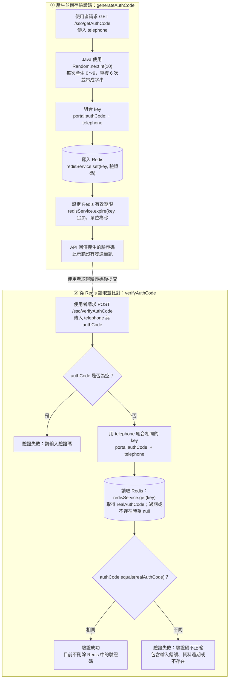

# mall-tiny-03：Redis 驗證碼的用途

本模組以「手機驗證碼」為例，示範 Spring Boot 如何使用 Redis 儲存短期資料、設定過期時間，以及讀取資料進行比對。

## 驗證碼的業務目的

手機驗證碼常用於會員註冊、登入或重設密碼。完整流程會將驗證碼透過簡訊發送到指定手機，使用者再輸入收到的驗證碼，讓後端確認使用者能收到該手機的簡訊。

Redis 在其中負責暫存正確的驗證碼，供後端核對；驗證碼由 Java 程式產生，簡訊則需要另外串接發送服務。

## 本模組的實際流程

1. 使用者呼叫 `GET /sso/getAuthCode`，提供 `telephone` 手機號碼。
2. 後端產生 6 位數驗證碼，以「固定前綴＋手機號碼」作為 Redis key，驗證碼作為 value。
3. 設定 120 秒有效期限，並直接在 API 回應中回傳驗證碼。
4. 使用者呼叫 `POST /sso/verifyAuthCode`，提供 `telephone` 與 `authCode`。
5. 後端依手機號碼從 Redis 讀取驗證碼，與使用者輸入的內容比對。相同則驗證成功；不相同或資料已過期，則驗證失敗。

### 產生與驗證流程圖

下圖對應目前的 `generateAuthCode` 與 `verifyAuthCode` 實作：



產生階段把 6 個數字串成**字串**，因此像 `"003821"` 這種開頭有零的驗證碼也會保留完整 6 位。程式先寫入 Redis，再另外設定 120 秒期限。

驗證階段不會重新產生驗證碼，而是用同一個手機號碼找到先前儲存的值。資料過期或不存在時，Redis 讀取結果為 `null`，與使用者提交的非空驗證碼比對就會失敗。同一手機號碼再次取得驗證碼時，會覆寫相同 key 的舊值，並重新設定有效期限。

例如，Redis 中暫存的資料可以理解為：

```text
key：portal:authCode:0912345678
value："582193"
有效期限：120 秒
```

前綴與有效期限設定於 [application.yml](application.yml)：

```yaml
redis:
  key:
    prefix:
      authCode: "portal:authCode:"
    expire:
      authCode: 120
```

## 為什麼適合使用 Redis？

驗證碼具有「資料小、存取頻繁、只需要短暫存在」的特性，適合放在 Redis：

- **讀寫快速**：產生驗證碼時寫入，驗證時讀取，操作簡單。
- **內建過期機制**：設定有效期限（TTL）後，過期資料會失效，不必另外安排清除過期驗證碼的工作。
- **能讓多台後端共用資料**：未來若部署多台後端，只要連到同一個 Redis 並使用相同的 key 規則，就能讀取同一份驗證碼。

驗證碼通常不需要長期保存。使用 Redis 可以省去為這類暫存資料設計資料表與清理流程的工作。

## 目前示範的範圍

- 驗證碼直接透過 API 回傳，尚未真正發送簡訊，因此目前無法藉此確認使用者持有該手機。
- 目前只實作產生、儲存及比對驗證碼，沒有完成會員註冊、登入或重設密碼流程。
- 驗證成功後沒有刪除驗證碼，所以在有效期限內仍可再次通過比對。

本章的核心是理解 Redis 如何管理短期資料，以及如何將這些操作整合進 Spring Boot 的業務流程。

## 對照程式碼

| 檔案 | 負責內容 |
| --- | --- |
| [UmsMemberController.java](../java/com/macro/mall/tiny/controller/UmsMemberController.java) | 提供取得與校驗驗證碼的 API |
| [UmsMemberServiceImpl.java](../java/com/macro/mall/tiny/service/impl/UmsMemberServiceImpl.java) | 產生驗證碼、組合 Redis key、設定期限及比對內容 |
| [RedisServiceImpl.java](../java/com/macro/mall/tiny/service/impl/RedisServiceImpl.java) | 封裝 Redis 的讀取、寫入與過期設定等操作 |
| [application.yml](application.yml) | 設定驗證碼 key 前綴與有效期限 |
