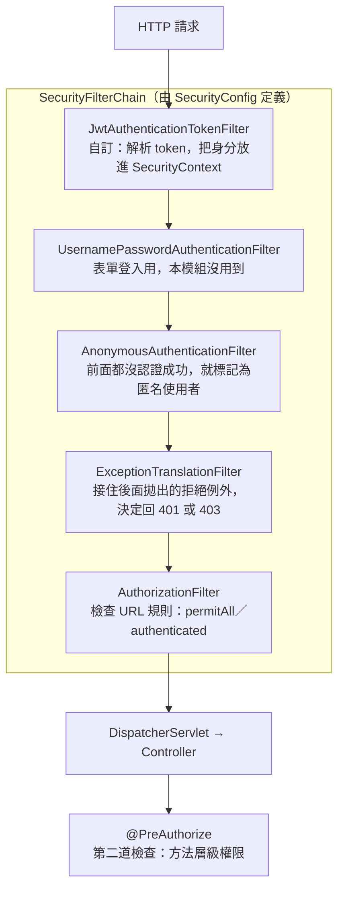
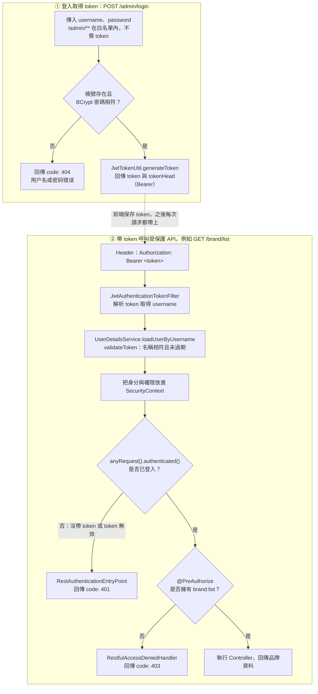

# mall-tiny-04：Spring Security + JWT 登入與權限控制

本模組在 mall-tiny-03（品牌 CRUD、Redis 驗證碼、PostgreSQL）的基礎上，加入 Spring Security 與 JWT，示範無狀態（stateless）的登入驗證，以及用 `@PreAuthorize` 依權限控制品牌 API。

與 mall-tiny-03 相比，[pom.xml](../../../pom.xml) 只多了兩個依賴：`spring-boot-starter-security` 與 `jjwt`（0.9.1）。

## 背景概念

### JWT 是什麼

JWT（JSON Web Token）是伺服器在登入成功後發給客戶端的一段**帶簽章的字串**，由三段組成，以 `.` 分隔：

```text
eyJhbGciOiJIUzUxMiJ9 . eyJzdWIiOiJhZG1pbiIsImNyZWF0ZWQiOi4uLn0 . 3kF9x...
      header                          payload                    signature
```

| 部分 | 內容 | 本模組中 |
| --- | --- | --- |
| header | 簽章演算法 | `{"alg":"HS512"}` |
| payload | 攜帶的資料（claims） | `{"sub":"admin","created":...,"exp":...}`：使用者名稱、簽發時間、到期時間 |
| signature | 用密鑰對前兩段算出的簽章 | `HMACSHA512(header + "." + payload, secret)` |

header 與 payload 只是 Base64URL 編碼，**沒有加密**，任何人都能解開來看。保護 token 的是簽章：一旦 payload 被改動，簽章就對不上，伺服器會拒絕這個 token。所以 JWT 保證「內容沒被竄改、確實由伺服器發出」，但不保證內容保密。

#### 為什麼用 JWT：與 Session 比較

HTTP 本身沒有狀態，登入之後的每個請求都要能證明「我是誰」。兩種做法的差別在於**登入狀態存在哪裡**：

| | Session | JWT |
| --- | --- | --- |
| 狀態存放處 | 伺服器記憶體（以 session ID 對應） | token 本身 |
| 客戶端攜帶 | cookie 中的 session ID | `Authorization: Bearer <token>` header |
| 伺服器如何識別 | 用 ID 查 session | 驗證簽章、讀出 payload |

JWT 帶來的好處：

- **容易水平擴充**：session 只存在某一台機器上，多台伺服器時需要 sticky session，或把 session 集中放到 Redis。用 JWT 的話，任何一台只要有同一把密鑰就能驗證。
- **適合前後端分離與 App**：token 放在 header，不依賴瀏覽器 cookie，手機 App 和跨網域前端都能用同一套方式。
- **不需要 CSRF 防護**：CSRF 利用的是瀏覽器「自動帶上 cookie」的行為；token 要由前端程式主動放進 header，不會被自動帶上。

JWT 的代價：

1. **發出後無法提早收回**：使用者登出、被停權或改密碼後，舊 token 在到期前（本模組為 7 天）仍然有效。常見補救方式是縮短有效期並搭配 refresh token，或在 Redis 維護黑名單；但加了黑名單，伺服器又得保存狀態。
2. **payload 是公開的**：不可放入密碼、身分證號等敏感資料。
3. **密鑰外洩就全面失守**：拿到密鑰的人可以自行簽出任何使用者的 token。

### Spring Security 是什麼

Spring Security 是 Spring 生態系中負責**認證**與**授權**的框架。它在請求到達 Controller 之前，用一串 filter 攔截並檢查請求：

| 問題 | 術語 | 失敗時 |
| --- | --- | --- |
| 你是誰？ | 認證（Authentication） | 401 |
| 你可以做這件事嗎？ | 授權（Authorization） | 403 |

JWT 只是回答「你是誰」的其中一種方式，也可以用 session、表單登入或 OAuth2。Spring Security 提供的是框架本身：在哪裡攔截、身分存在哪裡、如何判斷權限、失敗時如何回應。本模組的工作，就是把 JWT 接進這個框架。

#### Filter Chain

每個 HTTP 請求都會依序經過 `SecurityFilterChain` 中的十幾個 filter，下圖只列出與本模組相關的幾個：



被拒絕時會拋出 `AccessDeniedException`，`ExceptionTranslationFilter` 接到後依目前身分分流：

- **匿名使用者**（沒帶 token 或 token 無效）→ `AuthenticationEntryPoint`，即本模組的 `RestAuthenticationEntryPoint` → 401
- **已認證但權限不足** → `AccessDeniedHandler`，即本模組的 `RestfulAccessDeniedHandler` → 403

#### 核心元件與本模組的對應

| Spring Security 元件 | 作用 | 本模組中 |
| --- | --- | --- |
| `SecurityFilterChain` | 定義 URL 放行規則與要加入的 filter | `SecurityConfig.filterChain()` |
| `SecurityContextHolder` | 存放目前請求的身分；底層為 ThreadLocal，每個請求執行緒各有一份 | JWT filter 驗證通過後呼叫 `setAuthentication(...)` |
| `Authentication` | 身分物件：使用者、憑證、權限清單 | `UsernamePasswordAuthenticationToken` |
| `UserDetails` | 框架認得的使用者格式 | `AdminUserDetails` |
| `UserDetailsService` | 依使用者名稱回傳 `UserDetails` | `MallSecurityConfig` 中的 lambda |
| `GrantedAuthority` | 一項權限 | `brand:list` 等字串，包成 `SimpleGrantedAuthority` |
| `PasswordEncoder` | 密碼雜湊與比對 | `BCryptPasswordEncoder` |
| `AuthenticationEntryPoint` | 未認證時的回應 | `RestAuthenticationEntryPoint` |
| `AccessDeniedHandler` | 權限不足時的回應 | `RestfulAccessDeniedHandler` |
| 方法安全（`@EnableMethodSecurity`） | 以 AOP 代理在方法執行前檢查權限 | `PmsBrandController` 上的 `@PreAuthorize` |

#### 兩層授權

1. **URL 層級**（`SecurityConfig`）：較粗，只分「白名單放行」與「其餘都要登入」。
2. **方法層級**（`@PreAuthorize`）：較細，例如必須擁有 `brand:list`。

`GET /brand/{id}` 通過第一層、但沒有第二層註解，因此任何已登入的帳號都能呼叫。

#### 為什麼要改寫預設行為

只加入 `spring-boot-starter-security` 而不做任何設定時，Spring Security 會套用為傳統網頁設計的預設行為。本模組是前後端分離的 REST API，因此逐項換掉：

| 預設行為 | 本模組改為 |
| --- | --- |
| 用 session 記住登入 | `STATELESS`，每個請求由 JWT filter 重新建立身分 |
| 開啟 CSRF 防護 | 關閉 |
| 未登入時導向 HTML 登入頁 | 回傳 JSON 401 |
| 帳號 `user`、啟動時在 log 印出隨機密碼 | 自訂 `UserDetailsService`，提供 admin／macro 兩個帳號 |

因為是 `STATELESS`，`SecurityContext` 在請求結束後即被清除，不會留到下一個請求，所以 JWT filter 必須**每個請求都重新執行**。

#### 與「標準做法」的差異

閱讀其他教學或官方文件時，要注意本模組走了兩條捷徑：

1. **登入沒有經過 `AuthenticationManager`**：標準流程是把帳密交給 `AuthenticationManager`，由 `DaoAuthenticationProvider` 呼叫 `UserDetailsService` 與 `PasswordEncoder` 驗證；`UmsAdminServiceImpl.login()` 則是自己查使用者、自己呼叫 `passwordEncoder.matches()`。結果相同，只是少了框架的包裝。
2. **JWT 驗證是自己寫的**：Spring Security 內建 JWT 支援（`spring-boot-starter-oauth2-resource-server`），本模組改用自訂 filter 與 `JwtTokenUtil`，每個步驟都看得到，便於理解原理。

## 新增的元件

| 檔案 | 負責內容 |
| --- | --- |
| [SecurityConfig.java](../java/com/macro/mall/tiny/config/SecurityConfig.java) | 安全設定主體：白名單放行、其餘請求都需登入；關閉 CSRF、不使用 session；把 JWT filter 加在 `UsernamePasswordAuthenticationFilter` 之前；以 `@EnableMethodSecurity` 啟用 `@PreAuthorize` |
| [MallSecurityConfig.java](../java/com/macro/mall/tiny/config/MallSecurityConfig.java) | 提供 `UserDetailsService`，依使用者名稱取得帳號資料 |
| [IgnoreUrlsConfig.java](../java/com/macro/mall/tiny/config/IgnoreUrlsConfig.java) | 從 `secure.ignored.urls` 載入白名單 |
| [JwtAuthenticationTokenFilter.java](../java/com/macro/mall/tiny/component/JwtAuthenticationTokenFilter.java) | 每個請求都會經過：讀取 `Authorization: Bearer <token>`，解析出使用者名稱並驗證 token，通過後把身分放進 `SecurityContext` |
| [RestAuthenticationEntryPoint.java](../java/com/macro/mall/tiny/component/RestAuthenticationEntryPoint.java) | 未登入或 token 失效時，回傳 `code: 401` 的 JSON |
| [RestfulAccessDeniedHandler.java](../java/com/macro/mall/tiny/component/RestfulAccessDeniedHandler.java) | 已登入但權限不足時，回傳 `code: 403` 的 JSON |
| [JwtTokenUtil.java](../java/com/macro/mall/tiny/common/utils/JwtTokenUtil.java) | 產生、解析、驗證 JWT：HS512 簽章，payload 含 `sub`（使用者名稱）與 `created`，有效期 7 天 |
| [UmsAdminController.java](../java/com/macro/mall/tiny/controller/UmsAdminController.java) | `POST /admin/login` 登入並回傳 token；`POST /admin/resourceList` 列出資源清單 |
| [UmsAdminServiceImpl.java](../java/com/macro/mall/tiny/service/impl/UmsAdminServiceImpl.java) | 帳號與權限**寫死在記憶體**，沒有查資料庫；負責比對密碼並產生 token |
| [AdminUserDetails.java](../java/com/macro/mall/tiny/domain/AdminUserDetails.java) | 實作 `UserDetails`，把 `authorityList` 轉成 `GrantedAuthority` |
| [UmsResource.java](../java/com/macro/mall/tiny/domain/UmsResource.java) | 後台資源模型（權限名稱與對應 URL） |
| [SpringDocConfig.java](../java/com/macro/mall/tiny/config/SpringDocConfig.java) | 讓 Swagger UI 的 `/brand/**` API 帶上 `Authorization` header，可用 Authorize 按鈕貼入 token 測試 |

## 內建帳號與權限

`UmsAdminServiceImpl` 在 `@PostConstruct` 中建立兩個帳號，密碼都是 `123456`（以 BCrypt 加密後存放）：

| 帳號 | 權限 |
| --- | --- |
| `admin` | `brand:create`、`brand:update`、`brand:delete`、`brand:list`、`brand:listAll` |
| `macro` | `brand:listAll` |

[PmsBrandController.java](../java/com/macro/mall/tiny/controller/PmsBrandController.java) 的方法都標註了對應權限：

| API | 需要的權限 |
| --- | --- |
| `GET /brand/listAll` | `brand:listAll` |
| `POST /brand/create` | `brand:create` |
| `POST /brand/update/{id}` | `brand:update` |
| `GET /brand/delete/{id}` | `brand:delete` |
| `GET /brand/list` | `brand:list` |
| `GET /brand/{id}` | 無 `@PreAuthorize`，登入即可 |

因此以 `macro` 登入時，只能呼叫 `/brand/listAll` 與 `/brand/{id}`，其他品牌 API 會回傳 403。

## 請求流程



token 中只有使用者名稱，沒有權限。JWT filter 驗完 token 後，仍會呼叫 `loadUserByUsername` 取得權限清單。本模組的帳號存在記憶體，這一步幾乎沒有成本；若改為查資料庫，每個請求都會查詢一次，實務上通常會加 Redis 快取，或把權限寫進 token。

## 相關設定

JWT 與白名單設定於 [application.yml](application.yml)：

```yaml
jwt:
  tokenHeader: Authorization # 存放 JWT 的請求 header
  secret: mySecret           # 簽章用的密鑰
  expiration: 604800         # 有效期（秒），即 7 天
  tokenHead: Bearer          # token 前綴

secure:
  ignored:
    urls:                    # 不需登入的路徑
      - /swagger-ui/**
      - /v3/api-docs/**
      - /actuator/**
      - /druid/**
      - /admin/**
      # 以及 html、js、css、png 等靜態資源
```

## 動手體驗

### 0. 準備連線

本模組連到經 SSH tunnel 轉送的 PostgreSQL（`127.0.0.1:15432`）；`/sso/**` 的驗證碼功能另需 Redis（`localhost:6379`）。tunnel 的設定方式見根目錄 [README](../../../../README.md#postgresql-ssh-tunnel)，`db-tunnel.sh` 會同時建立兩條轉送：

```bash
cd <repo 根目錄>
./db-tunnel.sh start
./db-tunnel.sh status          # 兩條都顯示執行中才算好
export PG_PASSWORD='你的密碼'
```

### 1. 啟動

```bash
mvn -pl mall-tiny-04 spring-boot:run
```

應用使用 port 8080，請先確認沒有其他 mall-tiny 模組正在使用。啟動後保留這個終端機觀察 log：每個帶 token 的請求都會印出 `checking username:...`，驗證通過則再印出 `authenticated user:...`。

以下指令請在另一個終端機執行。`-w` 會另外印出 HTTP 狀態碼，方便與 JSON 中的 `code` 對照：

```bash
B=http://localhost:8080
W='  ← HTTP %{http_code}\n'
```

### 2. 實驗路線

#### ① 沒帶 token：被擋下

```bash
curl -s "$B/brand/listAll" -w "$W"
```

預期 JSON 為 `"code":401`，但 HTTP 狀態碼是 **200**（見下方「閱讀時要注意的地方」第 4 點）。

#### ② 密碼錯誤

```bash
curl -s -X POST "$B/admin/login?username=admin&password=wrong" -w "$W"
```

預期 `"code":404`、`用户名或密码错误`。`/admin/**` 在白名單內，所以不需要 token。

#### ③ 兩個帳號都登入，保存 token

```bash
ADMIN=$(curl -s -X POST "$B/admin/login?username=admin&password=123456" | jq -r '.data.token')
MACRO=$(curl -s -X POST "$B/admin/login?username=macro&password=123456" | jq -r '.data.token')
echo "$ADMIN"
```

#### ④ 解開 payload：JWT 沒有加密

```bash
p=$(echo "$ADMIN" | cut -d. -f2 | tr '_-' '/+'); while [ $(( ${#p} % 4 )) -ne 0 ]; do p="$p="; done
echo "$p" | base64 -d; echo
```

不需要密鑰就能看到 `{"sub":"admin","created":...,"exp":...}`，而且其中沒有權限資料。

#### ⑤ 以 admin 呼叫：通過

```bash
curl -s "$B/brand/listAll" -H "Authorization: Bearer $ADMIN" | jq '{code, count: (.data | length)}'
curl -s "$B/brand/list?pageNum=1&pageSize=3" -H "Authorization: Bearer $ADMIN" | jq '{code, total: .data.total}'
```

預期 `code: 200`，筆數等於 `pms_brand` 現有資料量；log 會出現 `authenticated user:admin`。

#### ⑥ 以 macro 呼叫：已登入但權限不足

```bash
curl -s "$B/brand/listAll" -H "Authorization: Bearer $MACRO" | jq .code   # 200：有 brand:listAll
curl -s "$B/brand/list"    -H "Authorization: Bearer $MACRO" -w "$W"      # code 403：沒有 brand:list
curl -s "$B/brand/1"       -H "Authorization: Bearer $MACRO" | jq .code   # 200：沒有 @PreAuthorize
```

這一步可以看出 401 與 403 的差別：401 是「不知道你是誰」，403 是「知道你是誰，但你不能做這件事」。

#### ⑦ 偽造 token：macro 冒充 admin

把 macro token 的 payload 換成 `{"sub":"admin"}`，header 與簽章維持原樣：

```bash
FAKE_P=$(printf '{"sub":"admin"}' | base64 | tr '+/' '-_' | tr -d '=')
FORGED="$(echo "$MACRO" | cut -d. -f1).$FAKE_P.$(echo "$MACRO" | cut -d. -f3)"
curl -s "$B/brand/list" -H "Authorization: Bearer $FORGED" -w "$W"
```

預期 `"code":401`，log 出現 `JWT格式验证失败`：payload 被改動，簽章就對不上。

#### ⑧ 白名單內外的對照

```bash
curl -s -X POST "$B/admin/resourceList" -w "$W"                    # 不需 token
curl -s "$B/sso/getAuthCode?telephone=13800000000" -w "$W"         # code 401：/sso 不在白名單
curl -s "$B/sso/getAuthCode?telephone=13800000000" -H "Authorization: Bearer $MACRO" | jq .
```

同一支驗證碼 API，在 mall-tiny-03 不需登入，在本模組則要帶 token。

### 3. 選做實驗

**寫入權限**：以 admin 建立一筆資料，讓 macro 嘗試刪除，最後務必以 admin 刪除，讓 `pms_brand` 回到原本的筆數：

```bash
ID=$(curl -s -X POST "$B/brand/create" -H "Authorization: Bearer $ADMIN" \
  -H 'Content-Type: application/json' -d '{"name":"JWT測試","firstLetter":"J"}' | jq '.data.id')
curl -s "$B/brand/delete/$ID" -H "Authorization: Bearer $MACRO" | jq .code   # 403
curl -s "$B/brand/delete/$ID" -H "Authorization: Bearer $ADMIN" | jq .code   # 200
```

**token 過期**：停掉應用，把有效期縮短為 30 秒後重新啟動：

```bash
mvn -pl mall-tiny-04 spring-boot:run -Dspring-boot.run.arguments=--jwt.expiration=30
```

重新登入取得 token，立即呼叫 `/brand/listAll` 得到 200；等 30 秒後再呼叫，會變成 401。

**Swagger UI**：開啟 `http://localhost:8080/swagger-ui/index.html`，先以 `/admin/login` 取得 token，再點右上角 Authorize 填入 `Bearer <token>`（中間有空格），即可在頁面上呼叫品牌 API。

### 4. 收尾

在執行應用的終端機按 `Ctrl+C` 停止應用，再執行 `./db-tunnel.sh stop` 關閉 tunnel。

## 閱讀時要注意的地方

1. **`/sso/**` 不在白名單內。** 從 mall-tiny-03 延續的 `/sso/getAuthCode`、`/sso/verifyAuthCode`，在本模組沒帶 token 會回傳 401，行為與 03 不同。
2. **`GET /brand/{id}` 沒有 `@PreAuthorize`。** 只要登入即可呼叫，`macro` 也能存取。
3. **`/admin/resourceList` 是公開的。** 整個 `/admin/**` 都在白名單內；資源清單只用來展示，實際權限判斷沒有用到它。
4. **401／403 只出現在 JSON 的 `code` 欄位。** `RestAuthenticationEntryPoint` 與 `RestfulAccessDeniedHandler` 沒有呼叫 `response.setStatus`，HTTP 狀態碼本身仍是 200。
5. **JWT secret 是 `mySecret`**，直接寫在設定檔中，只適合教學示範。正式環境應使用夠長的隨機密鑰，並從環境變數或 secret 管理服務讀取。
6. [mall_arch_04.md](../../../../docs/architect/mall_arch_04.md)、[mall_arch_05.md](../../../../docs/architect/mall_arch_05.md) 描述的是從資料庫查詢帳號與權限的版本，與本模組寫死在記憶體的做法不同，不能直接對照。
